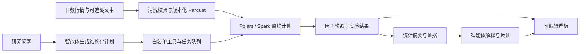

# 大数据与 AI 智能体的下一步结合

以下是针对当前日频股票研究系统的设计建议；本次已实现的是可视化看板及助手读取看板历史数据。下列自动研究流程尚未实现。

优先做「因子研究 → 批量实验 → 看板呈现」这一条闭环。项目已有日频行情、76 个因子、COGRASP、情绪融合 LightGBM 和策略实验入口，能直接复用计算与结果，不必再扩充一批独立模型。

| 优先级 | 结合位置 | 用户操作示例 | 智能体负责 | 数据引擎负责与产物 |
| --- | --- | --- | --- | --- |
| 第一批 | 因子库：因子研究智能体 | “检验十日异动因子在不同市场状态下是否有区分度” | 形成研究假设，选择已有因子或白名单公式，解释支持与反对证据 | 批量计算覆盖率、IC、分组收益、分年度稳定性；保留样本外结果及研究卡片 |
| 第一批 | 策略实验：实验编排智能体 | “比较动量与低波动策略，调仓周期用 5、10、20 日” | 将问题转换为有限参数组，整理结果，解释回撤与换手来源 | 后台任务队列执行确定性回测，记录成本、成交限制、数据版本和全部尝试；输出比较看板 |
| 第一批 | 可视化：自然语言建看板 | “比较这两只股票近半年的收益率、成交量和异动标记” | 生成结构化图表配置并预览，选择合适的图形 | 校验股票与指标白名单、区间和数量限制，复用本次历史查询接口；保存可编辑布局 |
| 第二批 | 数据后台：数据质量诊断智能体 | “为什么某股票最近的因子全空了” | 汇总异常与血缘信息，定位可能原因，生成修复建议 | 规则检测缺失、重复、延迟和价格口径不一致；输出受影响日期与可复现的修复任务 |
| 第二批 | 模型表现：模型诊断智能体 | “本月情绪融合模型为何与 COGRASP 分歧变大” | 解释分歧、漂移和误差切片，提出验证方案 | 计算特征分布漂移、行业误差、分数差异及相应模型解释；不能把解释等同于因果 |
| 后续 | 公告／新闻：事件因子流水线 | “把公告中的回购、减持、业绩变化转换成研究特征” | 提取事件、主体、时间和原文证据 | 去重、实体匹配、按可用时间入库与聚合；先补齐可追溯文本和使用许可，再评估增量效果 |

## 大数据技术如何接进去

建议采用下图的分工。当前体量优先保持 Parquet 与 Polars 查询；增加全市场、长期多源数据及批量实验时，再让 Spark 承担离线计算，按日期分区并产出可复用的因子快照。页面始终只读取已经筛选或聚合的结果。Spark 支持 Parquet 列式文件、分区发现与过滤下推，这为离线大批量处理和按需读取提供基础。[Spark Parquet 文档](https://spark.apache.org/docs/latest/sql-data-sources-parquet.html)

模型负责提出计划、调用受约束的工具和解释结果；收益率、相关性、回测、缺失率等数值由可复算程序完成。研究计划需要固定数据截止日期、股票池、成本假设、训练／验证／测试区间及尝试次数，防止只挑最好的一组历史结果。

每个任务记录输入、工具调用、数据版本、耗时和 Token 消耗，便于比较“有无智能体”的实际收益。可以先沿用项目实验记录，再按规模接入 MLflow tracing；其官方文档说明了逐步输入输出、延迟、Token 用量和评估结果的跟踪能力。[MLflow tracing 文档](https://mlflow.org/docs/latest/genai/tracing/)

## 推荐第一条可交付闭环

从“比较两个因子”开始：用户选择因子和历史区间 → 智能体生成最多 6 组研究计划 → 数据引擎产生样本外统计、成本后回测和失败记录 → 智能体写出结论与反证 → 自动生成可编辑的看板。保留所有实验及其版本，让用户能够回到任意一次研究，而不是只得到一段无法复核的聊天回答。

实现顺序建议为：自然语言生成受约束看板配置、批量实验编排、因子诊断，随后再扩展数据质量诊断和文本事件。预算上限、取消任务与进度可见性应与任务编排同时完成，长期任务在后台运行，避免拖慢网页。
